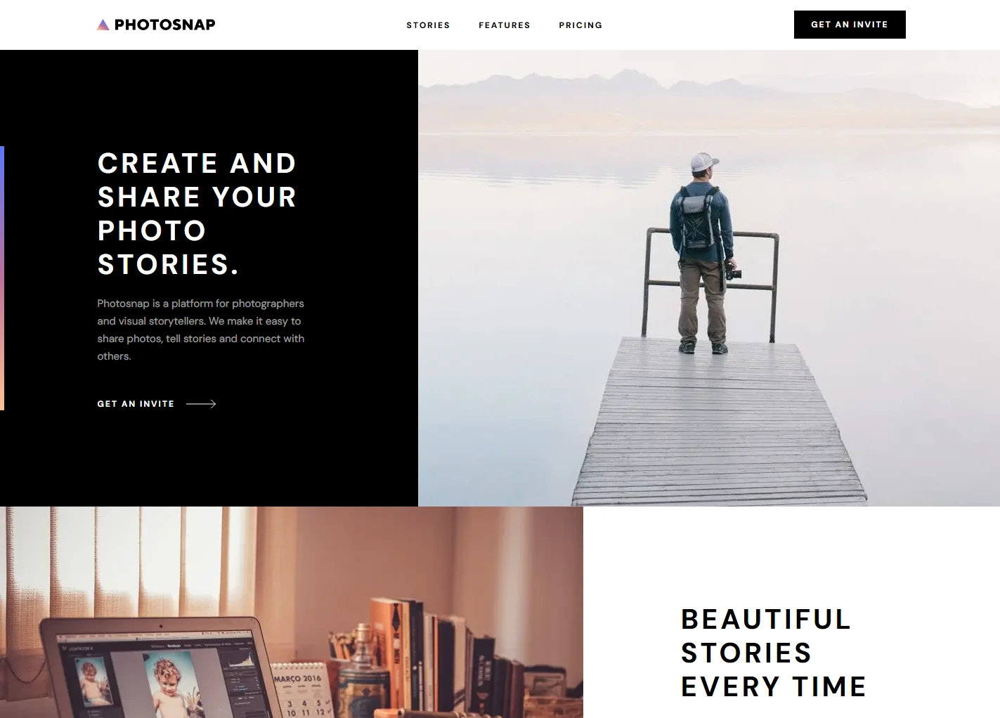
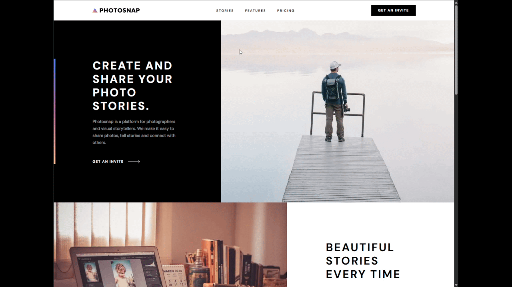
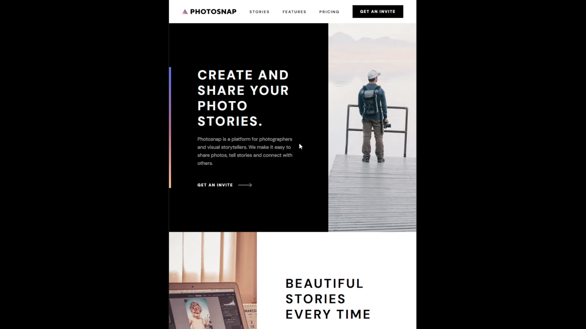
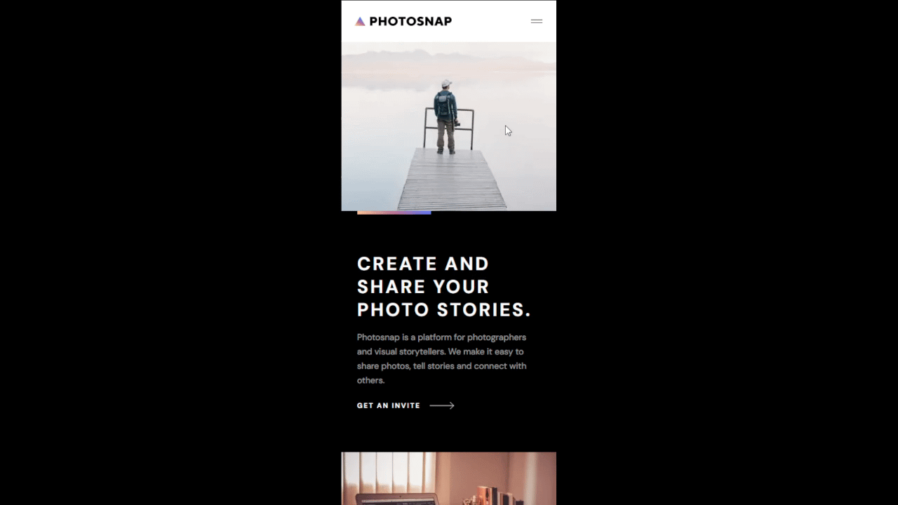

# Frontend Mentor - Photosnap Multi-page Website

A responsive, multi-page photography website built as a solution to the [Photosnap Multi-page Website challenge](https://www.frontendmentor.io/challenges/photosnap-multipage-website-nMDSrNmNW) on Frontend Mentor.

**[Live Demo](https://photosnap-multi-page-quiroz.vercel.app/)** · **[Source Code](https://github.com/Quirozdev/photosnap-multi-page)**



## Table of Contents

- [Getting Started](#getting-started)
  - [Prerequisites](#prerequisites)
  - [Installation](#installation)
- [Overview](#overview)
  - [Pages](#pages)
  - [Responsive Design &amp; Accessibility](#responsive-design--accessibility)
- [Demo](#demo)
  - [Desktop](#desktop)
  - [Tablet](#tablet)
  - [Mobile](#mobile)
- [Built With](#built-with)
- [Author](#author)

## Getting Started

### Prerequisites

- [Node.js](https://nodejs.org/) (20.9 or later)
- [pnpm](https://pnpm.io/) (12.16.1)

### Installation

**1. Clone the repository**

```bash
git clone https://github.com/Quirozdev/photosnap-multi-page.git
cd photosnap-multi-page
```

**2. Install dependencies**

```bash
pnpm install
```

**3. Configure environment variables**

Create a `.env.local` file in the project root and configure the required environment variable:

```env
SITE_URL=http://localhost:3000
```

**4. Start the development server**

```bash
pnpm dev
```

Open [http://localhost:3000](http://localhost:3000) with your browser to see the application.

**5. Run a production build (optional)**

```bash
pnpm build
pnpm start
```

**6. Run ESLint**

```bash
pnpm lint
```

## Overview

Photosnap is a photography website concept for photographers and visual storytellers to discover, create, and share visual stories. It features four pages covering the platform's stories, features, and pricing plans.

### Pages

**Home**

- Discover the platform through a prominent hero section.
- Explore featured stories and product features.
- Navigate to the Stories and Features pages.

**Stories**

- Browse a collection of photography stories.
- Discover the featured story.
- Explore story cards with their images, publication dates, and authors.

**Features**

- Explore the platform's features and capabilities.
- Browse feature descriptions and illustrations.
- Discover how Photosnap supports photographers and visual storytellers.

**Pricing**

- Compare the Basic, Pro, and Business subscription plans.
- Switch between monthly and yearly billing options.
- Compare plan features using a responsive comparison table.

### Responsive Design & Accessibility

- Responsive layouts optimized for desktop, tablet, and mobile devices.
- Art-directed images with different assets for mobile, tablet, and desktop.
- Responsive navigation with keyboard support, including Escape to close the mobile menu.
- Hover and focus states for interactive elements.
- Accessible labels, semantic HTML, and appropriate ARIA attributes.

## Demo

### Desktop



### Tablet



### Mobile



## Built With

- [Next.js](https://nextjs.org/)
- [React](https://react.dev/)
- [TypeScript](https://www.typescriptlang.org/)
- [Tailwind CSS](https://tailwindcss.com/)
- [Class Variance Authority](https://cva.style/docs)
- [clsx](https://github.com/lukeed/clsx)
- [tailwind-merge](https://github.com/dcastil/tailwind-merge)
- [pnpm](https://pnpm.io/)

**Development Practices**

- Feature-based project organization.
- Next.js App Router and Server/Client Components.
- Reusable shared components and CVA-based component variants.
- Responsive image optimization and art direction using `getImageProps`.
- Mobile-first development workflow.
- SEO metadata, Open Graph, robots.txt, and sitemap.xml.

## Author

- GitHub - [@Quirozdev](https://github.com/Quirozdev)
